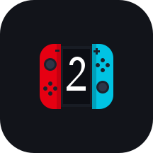

<p align="center"></p>

# NS2Native

Play your own copies of **Donkey Kong Bananza**, **Pokémon Pokopia**, and **Mario Kart World** natively on Android.

**NS2Native** is a fork of [BananaNative](https://github.com/moceure/BananaNative) (the Android port of [nxnative](https://github.com/seedds/nxnative) by seedds) specifically focused on and optimized for **Snapdragon 870 devices with 8 GB RAM** (ARMv8.2-A CPU architecture, Adreno 650 GPU).

This is not an emulator: the game's own 64-bit ARM code runs directly on the device's CPU, with Switch 2 graphics rebuilt on Vulkan. No game files, keys, or firmware are included in this repository or in the application.

> [!NOTE]
> **Key Focus & Optimizations for Snapdragon 870 / 8 GB RAM:**
> - **ARMv8.2-A PAC Instruction Stripping (`scripts/fix_armv82_pac.py`)**: ARMv8.2 CPUs (such as Qualcomm Snapdragon 870, 865, 855 with Cortex-A77/A76 cores) trigger `SIGILL` (Illegal Instruction crash) when encountering ARMv8.3 Pointer Authentication instructions (`retab`, `retaa`, `pacia`, `xpaci`). This fork automatically patches rewritten binaries to ensure stable execution on ARMv8.2 hardware.
> - **Lightweight Resolution Options (540p & 360p)**: Added lower rendering resolutions (Phone 540p / 0.5x and Phone 360p / 0.33x) in Settings and the in-game side panel to reduce GPU load on the Adreno 650, maintaining smooth and playable framerates.
> - **Memory Efficiency for 8 GB RAM (`shader_split.py`)**: Shader splitting has been optimized with a streaming disk write mechanism instead of holding all records in memory, preventing Out-Of-Memory (OOM) termination on 8 GB RAM devices.
> - **Linux & Cloud Packaging**: Cross-platform .NET runtime wrapper for `dmsh_xlate` and automated GitHub Actions workflows to compile APKs directly in the cloud without burdening local hardware.

## Games

| Game | Title ID | Version | Status |
|---|---|---|---|
| Donkey Kong Bananza | `040074A01BF12000` | update 458752 | Playable |
| Pokémon Pokopia | `0400A3A01EE4C000` | update 655360 | Playable (~60 fps) |
| Mario Kart World | `0400C3F00006E000` | 1.8.0 | In progress (experimental) |

Other game versions will be refused with a message displaying the required version.

## What you need

- **Device**: Android 13 or newer, 64-bit ARM. Optimized for **Snapdragon 870 with 8 GB RAM** (Adreno 650), or comparable Snapdragon chips (SD 865 / 865+ / 888 / 8 Gen 1+).
- **Custom GPU Driver**: Mesa Turnip driver (Adreno) is strongly recommended for the best Vulkan performance and stability on Adreno 650.
- **Game Dump**: Your own dump of the game as a folder structure (`base/`, `updates/`, `dlc/`). NSP and XCI container files do not work directly for Switch 2 titles.
  ```
  <game>/
    base/                  exefs/ and romfs/
    updates/<version>/     the update, if the version above is one
    dlc/<title id>/<n>/    extra content, if you have it
  ```
- Free storage: Around 1-2 GB of free internal storage on the phone for the prepared game pack.
- Optional: Your own `Lossless.dll` from Lossless Scaling for Windows to enable frame generation (not included).

## Setup & How to start

Each game is prepared once: its code is rewritten for Android (including ARMv8.2 PAC instruction stripping) and its shaders are translated to Vulkan.

### On-Device Preparation (Phone Only)
1. Copy your game dump folder to phone storage (e.g., `Switch2/DonkeyKongBananza`).
2. Install the **NS2Native** APK from the [Actions](https://github.com/hidayat077/NS2Native/actions) / [Releases](https://github.com/hidayat077/NS2Native/releases) tab.
3. Open **NS2Native** and grant **All files access** permission.
4. Tap **Add game**, select the game folder, and tap **Prepare**. The process runs in a foreground background service with progress notifications.
5. Tap **Play** once preparation completes.

### Preparation via PC / Mac (Faster)
1. Set up Python with required dependencies:
   ```sh
   pip install "capstone>=5,<6" lz4
   ```
2. Run the packer script:
   ```sh
   python3 scripts/pack_android.py /path/to/<game>
   ```
   *(The script automatically executes `fix_armv82_pac.py` to strip ARMv8.3 PAC instructions).*
3. Copy the game folder and the generated pack folder (`<title_id>-work/android-pack`) to your phone's storage.
4. Open **NS2Native**, add the game folder, and launch.

## Features

- **ARMv8.2 & Adreno 650 Optimizations**: Built-in PAC stripping and custom resolution scaling down to 540p / 360p.
- **Fold-Aware UI**: Adaptive layout for foldable devices, switching between outer and inner screen configurations dynamically.
- **Frame Generation (LSFG)**: Lossless Scaling frame generation integration (2x, 3x, 4x, or target 60/90/120 fps) using your own `Lossless.dll`.
- **FSR 1 Upscaling**: AMD FidelityFX Super Resolution 1 with adjustable sharpness for crisp image presentation at lower resolutions.
- **On-Screen Touch Controls & Gamepad**: Translucent customizable on-screen controller overlay with full physical gamepad support.
- **In-Game Side Panel & Performance Overlay**: Real-time HUD monitoring fps, frame time, GPU render time, battery temperature, CPU frequencies, and RAM consumption.

## Credits and License

- Forked from **[BananaNative](https://github.com/moceure/BananaNative)** by moceure.
- Built on top of **[nxnative](https://github.com/seedds/nxnative)** by seedds (MIT).
- Shader translator derived from Ryujinx, switch2mac (azmasm), and Eglantine (djihads80).
- Frame generation ported from Eden and lsfg-vk.

The Android application is licensed under **GPL-3.0-or-later** ([android/NOTICE.md](../android/NOTICE.md)).
Only use dumps of games you legitimately own. Do not ask for or share copyrighted game files, keys, or ROMs.
